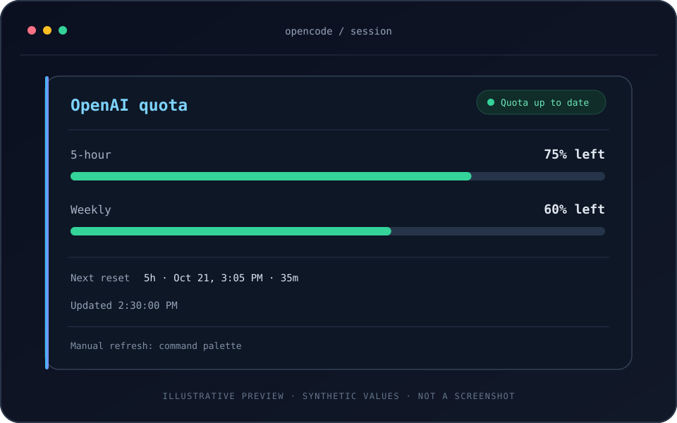

<h1 align="center">OpenAI Quota for OpenCode</h1>

<p align="center">See how much OpenAI subscription quota remains without leaving OpenCode.</p>

<p align="center">
  <a href="#quick-install"></a>
  <a href="#quick-install"></a>
</p>

<p align="center"><a href="#quick-install"><strong>Quick install ↓</strong></a></p>

<p align="center">
  
</p>

<p align="center"><sub>SVG recreation of the actual panel with example values—not a captured screenshot. Appearance varies by terminal, font, and theme.</sub></p>

## What it does

Adds a small quota panel to OpenCode's sidebar so you can see the 5-hour and weekly OpenAI subscription windows, their remaining percentages, the next known reset time, and available banked Codex resets. It uses quota information OpenAI returns for an OpenAI OAuth login; it is not an API billing, usage-credit, token, or cost tracker.

## Quick install

> This is a source-checkout install. The package is marked `private` in `package.json`, so there is no published npm package to install.

### 1. Get the source

Clone the repository into a permanent folder; OpenCode uses the checkout path after configuration.

```sh
git clone https://github.com/arturobuendia/opencode-openai-quota.git
```

Keep the checkout in place after configuring the plugin.

### 2. Add the local plugin to `tui.json`

OpenCode's TUI plugin configuration is **`tui.json`** (not `opencode.json` or `opencode.jsonc`). Add the plugin's absolute `file:` URL to the top-level `plugin` array. If the file already exists, merge this entry into its existing array and preserve the other settings and plugins.

Default config locations:

- **Windows:** `%USERPROFILE%\.config\opencode\tui.json`
- **macOS/Linux:** `~/.config/opencode/tui.json` (or `$XDG_CONFIG_HOME/opencode/tui.json` when `XDG_CONFIG_HOME` is set)
- **Any platform:** use `tui.json` inside the directory selected by `OPENCODE_CONFIG_DIR`, if set.

Example `tui.json`:

```json
{
  "$schema": "https://opencode.ai/tui.json",
  "plugin": [
    "file:///ABSOLUTE/PATH/TO/opencode-openai-quota/src/tui.js"
  ]
}
```

Replace the example URL with the absolute path to `src/tui.js` in your extracted checkout. Use forward slashes in the URL; URL-encode spaces as `%20`.

```text
Windows:  file:///C:/Users/YOU/Projects/opencode-openai-quota/src/tui.js
macOS:    file:///Users/YOU/Projects/opencode-openai-quota/src/tui.js
Linux:    file:///home/YOU/Projects/opencode-openai-quota/src/tui.js
```

### 3. Restart OpenCode and connect OpenAI

Restart OpenCode so it loads the TUI configuration. Sign in to OpenAI through OpenCode's normal **OAuth** login flow; the plugin reuses that existing login and does not ask you to copy or share a token. API-key authentication does not provide the subscription quota shown here.

## What appears in the sidebar

The panel shows:

- **5-hour** and **Weekly** windows when those windows are present in the usage response.
- **Remaining quota**, not used quota. For example, `25% used` is displayed as `75% left`.
- The **earliest known reset**, formatted in local time with a countdown. If no reset is available, the panel says so.
- **Available banked resets**, including a genuine `0`, and the next expiration when the service provides a complete, valid detail list. The count is unavailable if the usage response lacks a valid count; expiration is unavailable when reset details are missing, incomplete, inconsistent, or have an unknown expiration.
- Banked resets are manually redeemable benefits, separate from automatic resets and purchased usage credits. The plugin only displays their count and expiration; it never redeems them. See [OpenAI's reset guide](https://help.openai.com/en/articles/20001498-how-resets-work-in-codex) for the distinctions and offer terms.
- Refresh status and the time of the last successful update.

The plugin refreshes on startup and every **2 minutes**. The countdown clock updates every **30 seconds**. To refresh sooner, open OpenCode's command palette and choose **Refresh OpenAI quota** (category **OpenAI quota**).

| Sidebar message | Meaning |
| --- | --- |
| `Quota up to date` | Latest request returned quota data. |
| `Connection issue · showing last good quota` | A refresh failed; the last successful values remain visible as stale data. |
| `Session expired · reconnect in OpenCode` | Reconnect the OpenAI OAuth account in OpenCode. |
| `API key auth · subscription quota n/a` | OpenCode is using API-key auth; subscription quota is not available through that login. |
| `Connect OpenAI OAuth` | OpenCode does not currently have an OpenAI OAuth login. |
| `Quota unavailable · will retry` | No usable quota is available yet; the plugin will try again. |

## Compatibility

Use **OpenCode CLI/TUI 1.18.35 or newer** as a conservative documented baseline. The [upstream v1.18.35 TUI plugin reference](https://github.com/anomalyco/opencode/blob/v1.18.35/packages/opencode/specs/tui-plugins.md) documents `tui.json`, local `file:` plugin paths, and the sidebar, command-palette, and lifecycle APIs this plugin uses. This repository does not declare a formal `engines.opencode` range, so older versions are not guaranteed.

The plugin uses OpenCode's TUI/Solid runtime; you do not need to install a separate `solid-js` package for it.

## Privacy and network behavior

Quota refresh uses OpenAI's fixed HTTPS usage endpoint, `https://chatgpt.com/backend-api/wham/usage`, and, when available banked resets are reported, its reset-detail endpoint, `https://chatgpt.com/backend-api/wham/rate-limit-reset-credits`. Both requests use the OAuth credential OpenCode already manages, reject redirects, omit cookies, disable caching, and do not send a referrer. The credential is used in-process and is not included in the sidebar snapshot or sanitized request errors. This makes direct network requests to `chatgpt.com` when quota is refreshed.

## Troubleshooting

- **No panel after restart:** confirm the entry is in `tui.json`, the JSON is valid, and the absolute `file:` URL points to this checkout's `src/tui.js`.
- **API-key or not-connected message:** connect OpenAI through OpenCode with OAuth; an API key is not a substitute for subscription quota access.
- **Expired or connection issue:** reconnect if prompted. For a temporary network failure, the last good values stay visible; use **Refresh OpenAI quota** to retry.
- **Quota reset says unavailable:** the service did not provide a usable reset time for the returned window.
- **Banked reset expiration says unavailable:** the count may still be known, but the service did not provide a complete, consistent list of available resets with valid expiration timestamps. The plugin does not infer expiration from regular quota reset times.

## Development

Node.js **20 or newer** is required for the package's development/test scripts. No npm dependencies are declared by this package.

```sh
npm test
npm run check
```

- `npm test` runs the offline Node.js test suite.
- `npm run check` syntax-checks the source and runs the Bun TUI host harness. It requires Bun and the OpenCode TUI packages to be resolvable from OpenCode's config directory.

## Uninstall

Remove this plugin's `file:` URL from the `plugin` array in `tui.json`, preserve any other entries, and restart OpenCode. You can then delete the source checkout.
